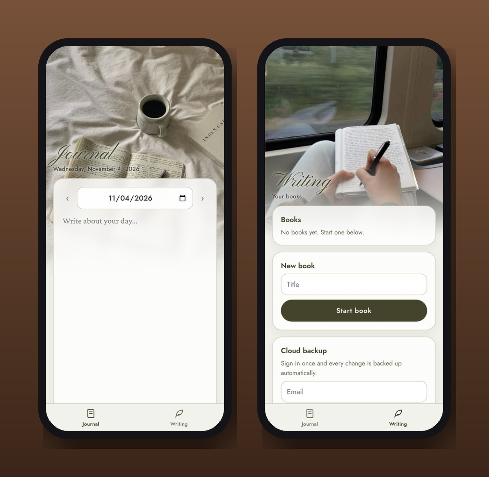
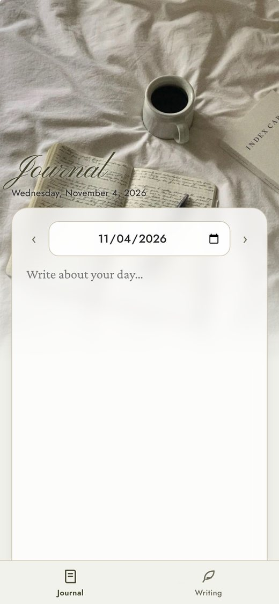
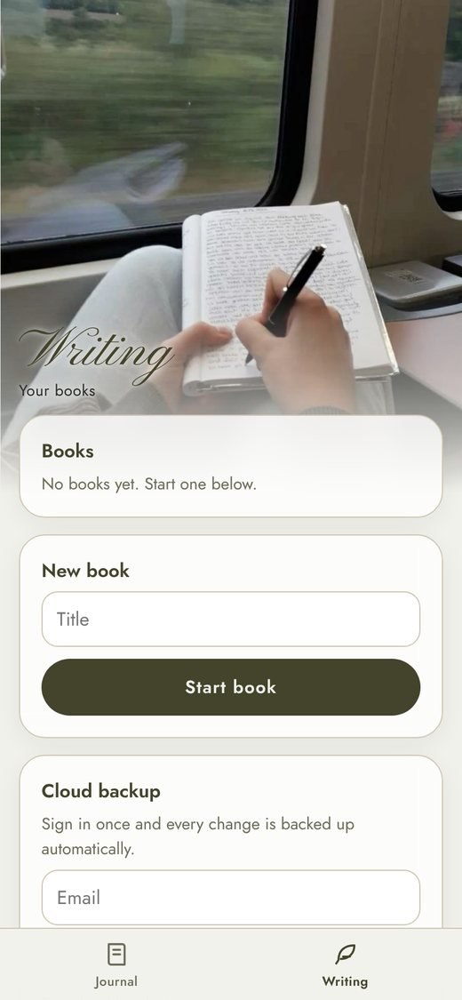

<h1 align="center">Writing (Pages)</h1>

<em>A journal for every day, and a desk for the book you're writing.</em>

<a href="https://joshp523.github.io/writing-app/"><b>▶ Open the app</b></a>

Pages is a calm place to write. One side is a daily journal; the other is a writing desk for longer projects, organized into sections you can rearrange.

## What you can do

- **Journal:** one page per day. Flip back and forth by date.
- **Writing:** start a book, split it into chapters and sections, move them around, and nest them into an outline.
- **Word goals:** set a target and watch the count climb.
- **Export:** take your writing anywhere as a plain text file.
- **Cloud backup:** sign in once and every change is saved automatically.

<table><tr><td align="center" valign="top"> Journal</td><td align="center" valign="top"> Writing desk</td></tr></table>
## Why it's worth a look

- **Cool:** It looks and feels like a quiet morning: coffee, linen and an open notebook.
- **Innovative:** Journal and manuscript live side by side, so a thought from this morning's entry can become tomorrow's chapter.
- **Impressive:** An outline editor, word goals, export and automatic backup, in a page small enough to load instantly.
- **Useful:** Write on the phone in line at the shop, pick up on the iPad at home. Nothing is ever lost.

---

### On your phone
Open the link in Safari (iPhone/iPad) or Chrome (Android), then choose **Share → Add to Home Screen**. It gets its own icon and opens full-screen, just like an app from the store.

### More apps by Josh Riley
[The Riley Rag](https://joshp523.github.io/RileyRag/) · [QuipRash](https://joshp523.github.io/Quip-game-app/) · [Word Games](https://joshp523.github.io/Word-Games/) · [Russian Verbs](https://joshp523.github.io/russian/) · [Riley Rangers](https://joshp523.github.io/Rangers-app/) · [Habits: Josh](https://joshp523.github.io/daily-discipline/) · [Habits: Meishe](https://joshp523.github.io/Habit-tracker-app-Meishe/) · [Habits: Grandma](https://joshp523.github.io/wendys-app/)

Built by Josh Riley.
