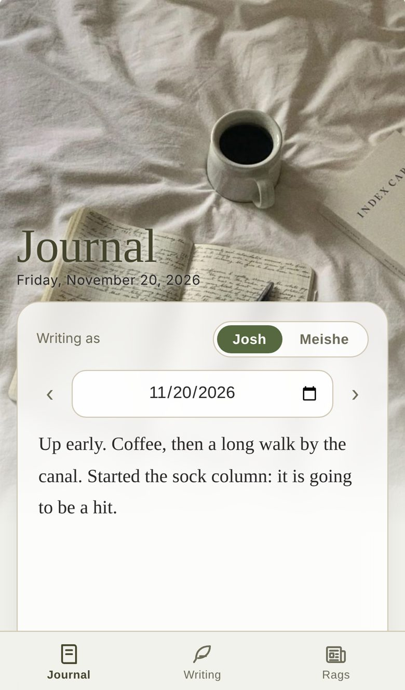
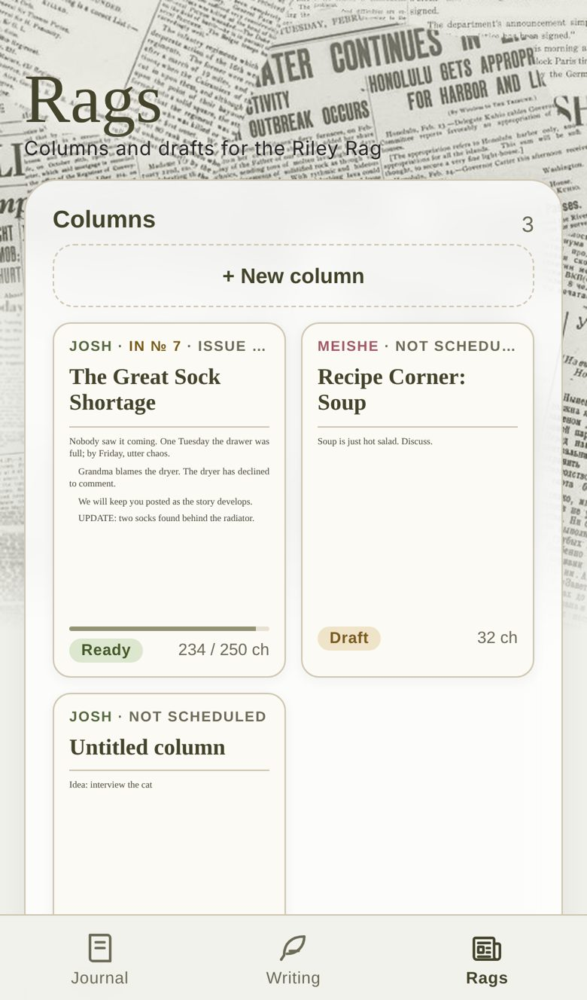
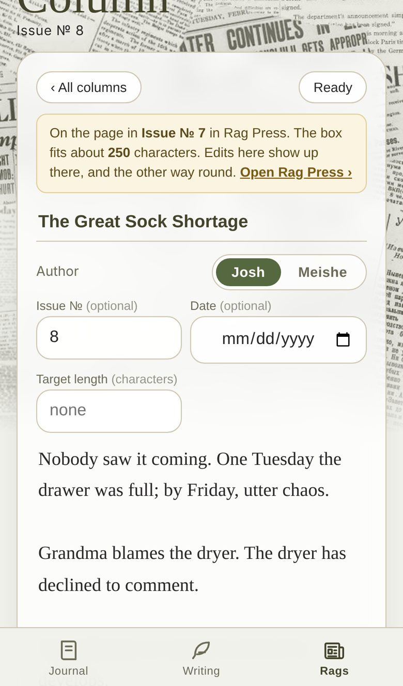

<h1 align="center">Pages</h1>
<h3 align="center">Journal it. Draft it. Print it. One flow, from first idea to the front page.</h3>

<a href="https://joshp523.github.io/writing-app/"><b>▶ Open the app</b></a>

<table><tr>
<td align="center"> <b>Journal</b></td>
<td align="center"> <b>The Rags desk</b></td>
<td align="center"> <b>A column, live on the page</b></td>
</tr></table>

## ✦ New: straight to the press
**Write here. It's already on the page.** Drop a column into a Riley Rag layout in Rag Press, and it stays live-linked. Fix a typo in either app and both update.

**Know exactly how much fits.** Once a column is on a page, Pages shows the box's real capacity: *"fits about 2,400 characters"*. The length bar fills as you write, and turns red when you're over.

**See where everything lives.** Columns on a page wear a gold *In № 8* badge.

## ✦ A desk for every idea
- **Rags.** Every column from first scribble to *Published*: Idea, Draft, Ready. Plan by issue or date, or keep it in the idea pile until it finds a home.
- **Suggested edits.** Josh and Meishe mark up each other's columns, red ink and all, then accept or reject with a tap. While edits are open, the page in Rag Press waits.
- **Writing.** Books, chapters and sections, with an outline you can rearrange.
- **Journal.** One page per person per day. Flip back through the year.

## ✦ Quietly reliable
Everything saves on your phone first and backs up to the cloud automatically. Write on the phone, finish on the iPad.

---

### On your phone
Open the link in Safari (iPhone/iPad) or Chrome (Android), then choose **Share → Add to Home Screen**. It gets its own icon and opens full-screen, just like an app from the store.

### More apps by Josh Riley
[The Riley Rag](https://joshp523.github.io/RileyRag/) · [QuipRash](https://joshp523.github.io/Quip-game-app/) · [Word Games](https://joshp523.github.io/Word-Games/) · [Russian Verbs](https://joshp523.github.io/russian/) · [Riley Rangers](https://joshp523.github.io/Rangers-app/) · [Habits: Josh](https://joshp523.github.io/daily-discipline/) · [Habits: Meishe](https://joshp523.github.io/Habit-tracker-app-Meishe/) · [Habits: Grandma](https://joshp523.github.io/wendys-app/)

Built by Josh Riley.
